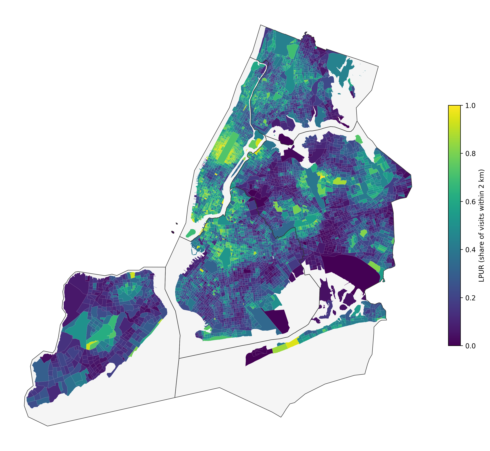
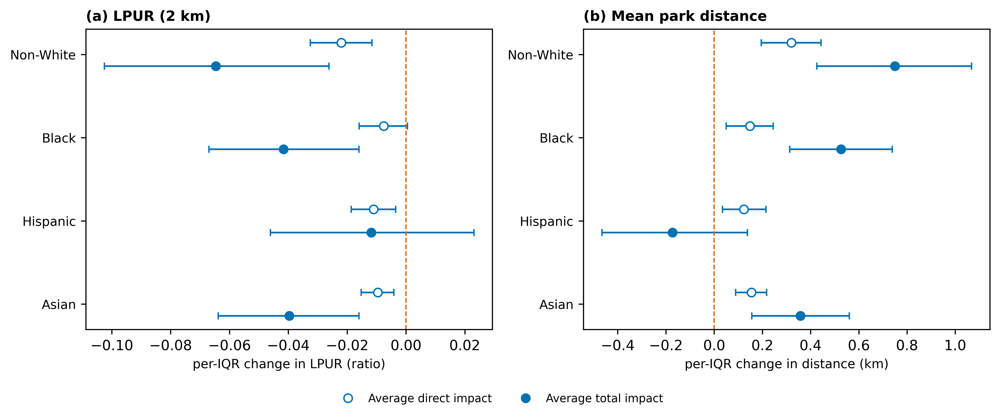
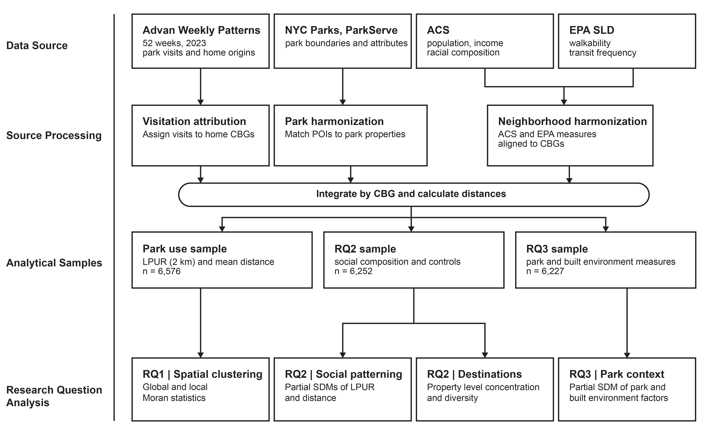

# Neighborhood Socio-Racial Composition and the Spatial Reach of Park Visitation in New York City

Analysis code for:

> Wu, T., Kong, J., & Shen, X. (2026). Neighborhood socio-racial composition and the spatial reach of park visitation in New York City. *Land*, 15(10), 1818. https://doi.org/10.3390/land15101818

## Question

Having a park nearby does not mean residents use it. Using a year of mobile-device visitation data, this project asks **whether residents of predominantly non-White neighborhoods direct a smaller share of their park visits to nearby parks, and travel farther to the parks they do use**, after accounting for park supply and spatial spillovers between neighborhoods.

## Key findings

- The **Local Park-Use Ratio (LPUR)**, the share of a block group's dwell-qualified park visits that go to parks within 2 km of home, is strongly spatially clustered (global Moran's I = 0.718, n = 6,576 block groups).
- Higher non-White share is associated with lower LPUR and a longer mean home-to-park distance. The association is larger once spatial spillovers are included (average total impact) than the direct impact alone.
- The association holds across 0.5–3 km radii, kNN-6 weights, alternative dwell thresholds, park-matching rules, and destination-concentration checks.

<p align="center"><br><em>Figure 3. LPUR by census block group</em></p>

<p align="center"><br><em>Figure 6. Average direct and total impacts from the partial spatial Durbin model (per-IQR change)</em></p>

## Workflow

<p align="center"></p>

### 1. Data preparation — `src/`

Scripts are numbered in execution order and follow a one-way `data/raw → data/interim → data/processed` pipeline.

| Script | Step |
|---|---|
| `10_prepare_base_geography.py` | NYC block-group base layer (TIGER 2023) |
| `11_process_acs.py` | ACS 2023 5-year: population, income, race/ethnicity |
| `12_process_parks.py` | Park properties and park-quality attributes |
| `13c_compute_access_e2sfca.py` | **E2SFCA accessibility** (6 km Gaussian catchment, σ = 3 km) |
| `13b_compute_access_2sfca.py`, `13d_access_water_barrier.py` | 2SFCA and water-barrier sensitivity |
| `14_process_mobile_visits.py` | Advan weekly patterns → park visits by home block group, **dwell ≥ 5 min** |
| `14b_`, `14c_`, `14d_` | Busiest-geofence, matched-park-universe, and dwell-threshold variants |
| `15b_compute_local_ratio.py` | **LPUR** at 11 radii (0.5–3 km) and mean home-to-park distance |
| `16_process_walkability.py`, `17_compute_transit.py` | EPA Walkability Index and Smart Location Database transit |
| `18_merge_analysis_dataset.py` | Block-group analysis dataset |
| `26_study_area_map.py` | Figure 1 |
| `31_lpur_framework.py`, `32_lpur_figures.py` | LPUR framework results and Figure 3 |
| `33_lpur_robustness.py`, `34_lpur_supply_control.py` | Measure-construction and same-scale supply-control robustness |

### 2. Final analysis — `outputs/<stage>/scripts/`

Each stage writes only into its own folder and reuses the frozen dataset from step 1.

| Stage | What it does | Paper |
|---|---|---|
| `lpur_revision_calculations_20260730` | LISA with Benjamini–Hochberg FDR, effect sizes, property de-duplication | Figure 4 |
| `spatial_model_reassessment_20260803` | OLS diagnostics, LM tests, SEM/SAR/SDM/SDEM/SARAR under Queen and kNN-6, impacts | Model selection |
| `figure_revision_20260803` | LPUR–distance relationship, robustness forest | Figure 5 |
| `final_sdm_revision_20260803` | **Partial spatial Durbin model** for RQ2/RQ3: direct, indirect, total impacts; 26-spec robustness | Figure 6, Tables |
| `final_additional_checks_20260807` | Collinearity, radius profiles, RQ3 impacts, destination analysis, corrections | Figures 7, 8, 10 |
| `destination_per_cbg_and_match_alignment_20260808` | Canonical POI–park crosswalk, per-CBG destination concentration (HHI) | Figure 9 |
| `destination_choice_set_check_20260813` | Choice-set check for destination concentration | Supplement |
| `manuscript_figures` | Final styling of Figures 2, 7, 8, 9, 10 | Figures |

### 3. Earlier framework (kept for transparency)

`src/19_`–`25_`, `27_`–`30_`, `31_run_unified_final_analysis.py`, `diagnostics_predictor_collinearity.py`, and `src/deprecated/` belong to an earlier two-stage access–use "mismatch" design. It was replaced by LPUR because the first-stage model explained almost none of the variation in use and the residual outcome was conceptually circular. These scripts are not needed to reproduce the published results.

## Data

Raw data are **not** included. See [`data/README.md`](data/README.md).

## Running

```bash
pip install -r requirements.txt
# run from the repository root
python src/10_prepare_base_geography.py
...
```

Scripts expect to be run from the repository root and require the licensed Advan data in `data/raw/`.

## Citation

```bibtex
@article{wu2026park,
  title   = {Neighborhood Socio-Racial Composition and the Spatial Reach of Park Visitation in New York City},
  author  = {Wu, Tianye and Kong, Jie and Shen, Xiwei},
  journal = {Land},
  volume  = {15}, number = {10}, pages = {1818}, year = {2026},
  doi     = {10.3390/land15101818}
}
```
